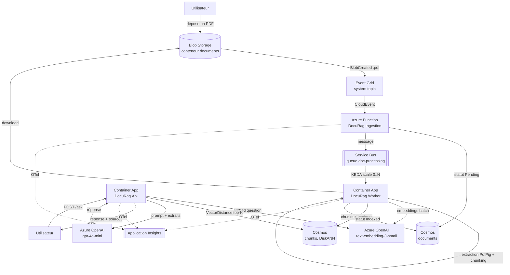

# Architecture

DocuRAG est un pipeline d'ingestion event-driven suivi d'une API de question-réponse
avec recherche vectorielle. Tout est authentifié par **managed identity** (aucune
connection string), instrumenté avec **OpenTelemetry** et déployé par **Bicep + azd**.

## Vue d'ensemble

## Trace distribuée

Le `traceparent` de l'activité courante est injecté dans les propriétés applicatives
du message Service Bus à l'émission (`ServiceBusDocumentQueue`) puis restauré côté
worker (`Worker.StartLinkedActivity`). La trace reste donc continue depuis l'upload
jusqu'à l'écriture Cosmos, en traversant la queue.

## Idempotence

Les chunks ont un id déterministe `{documentId}-{chunkIndex}` et le `documentId` dérive
du chemin du blob (`DocumentIdentity`). Rejouer un message (retry, redelivery) ré-écrit
les mêmes chunks au lieu d'en créer des doublons.

## Résilience

- Message illisible → dead-letter immédiat.
- Échec de traitement → abandon, rejeu jusqu'à `maxDeliveryCount` (5), puis dead-letter
  automatique par le broker.
- Appels Azure OpenAI : retry exponentiel sur 429 (politique du client).
- Un PDF corrompu finit en DLQ avec un motif lisible, sans faire tomber le worker.
- `GET /dead-letters?max=N` (API) liste la DLQ en *peek* : identifiant du document,
  motif (`DeadLetterReason`), description, nombre de livraisons. Aucun message n'est consommé.

## Stockage Cosmos

| Conteneur   | Partition      | Contenu                                    |
|-------------|----------------|--------------------------------------------|
| `documents` | `/id`          | métadonnées + statut du document           |
| `chunks`    | `/documentId`  | texte + page + vecteur `/embedding` (DiskANN) |

La recherche utilise `VectorDistance(c.embedding, @vec)` avec `ORDER BY`, top-K = 5,
filtre optionnel par `documentType`.
