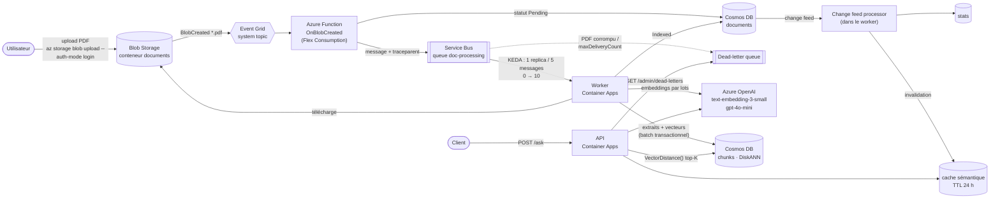
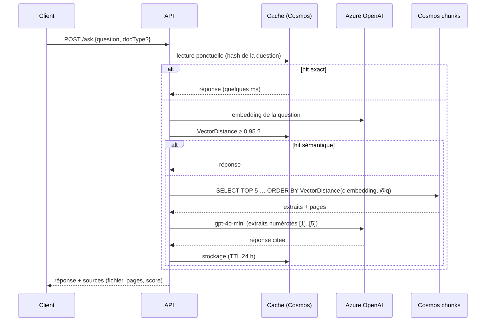

# Architecture DocuRAG

## Vue d'ensemble

## Flux d'une question (`POST /ask`)

## Choix et justifications

| Sujet | Choix | Pourquoi |
|---|---|---|
| Découplage | Event Grid → Function légère → Service Bus → worker | La Function répond vite à Event Grid ; le travail lourd (embeddings, throttling) scale à part sur la longueur de la queue. |
| Idempotence | id document = SHA-256 du chemin du blob ; id extrait = `{documentId}-{index}` ; upsert + suppression des extraits orphelins | Service Bus et le change feed sont « at least once ». Un message rejoué réécrit les mêmes items. |
| Erreurs | `InvalidPdfException` → dead-letter immédiat (`InvalidPdf`) ; autre erreur → abandon, DLQ après 5 tentatives | Retenter un PDF corrompu ne sert à rien ; une erreur réseau, si. |
| Throttling | `RetryPolicy` : backoff exponentiel + jitter, respecte `Retry-After` | Le retry du SDK est désactivé pour que le comportement soit explicite et testé. |
| Recherche | Cosmos DB NoSQL, index DiskANN, cosinus, 1536 dims | Une seule base pour les documents, les vecteurs, le cache et les stats. Filtre par `docType` dans la même requête. |
| Citations | chaque extrait garde `pageStart` / `pageEnd` | La réponse cite fichier + page : vérifiable. |
| Cache | Cosmos (au lieu de Redis), 2 niveaux exact/sémantique, TTL + invalidation par change feed | Pas de ressource payante en plus ; Azure Managed Redis avec recherche vectorielle n'a pas de tier gratuit. |
| Sécurité | 3 managed identities user-assigned, RBAC au plus près de la ressource, `disableLocalAuth` sur Cosmos / Service Bus / OpenAI, `allowSharedKeyAccess=false` sur le storage | Aucune clé ni chaîne de connexion dans le code ou la configuration. |
| Config | App Configuration (+ feature flag `SemanticCache`, rafraîchi toutes les 30 s), Key Vault pour la chaîne App Insights | On coupe le cache sans redéployer. |
| Traces | `traceparent` dans les ApplicationProperties du message Service Bus | Une seule trace de l'upload à l'écriture Cosmos. |

## Rôles RBAC

| Identité | Rôles |
|---|---|
| `id-docurag-ingestion` | Storage Blob Data Owner (runtime Functions + package), Service Bus Data Sender (queue), Cosmos DB Built-in Data Contributor, Key Vault Secrets User |
| `id-docurag-worker` | Storage Blob Data Reader, Service Bus Data Owner (namespace — requis par le scaler KEDA), Cognitive Services OpenAI User, Cosmos DB Built-in Data Contributor, AcrPull, App Configuration Data Reader, Key Vault Secrets User |
| `id-docurag-api` | Service Bus Data Receiver (queue — lecture de la DLQ), Cognitive Services OpenAI User, Cosmos DB Built-in Data Contributor, AcrPull, App Configuration Data Reader, Key Vault Secrets User |
| Développeur (`azd`) | Storage Blob Data Contributor, Service Bus Data Owner, OpenAI User, App Configuration Data Reader, Cosmos DB Data Contributor — pour lancer les services en local |
